# Awesome-SSL-TLS-Certificate-Key-Management

# 🔐 Awesome SSL/TLS Certificate & Key Management 🔑

**🚀 A curated index of top enterprise SSL/TLS Certificate Lifecycle Management (CLM) platforms, Machine Identity Management solutions, and open-source Public Key Infrastructure (PKI) software.**

*🛡️ Master certificate issuance, ACME protocol automation, short-lived certificate renewals, post-quantum crypto agility, and private key security.*

[📈 Sector Overview](#-sector-overview--market-dynamics) • [🟦 SaaS Solutions](#-saas--hosted-platforms) • [🟩 Open-Source PKI & ACME](#-open-source-software) • [📊 Comparison](#-comparison-at-a-glance) • [⭐ Star History](#-star-history) • [💖 Support](#-support) • [🤝 Contributing](#-contributing)

---

## 📋 Table of Contents

- [📈 Sector Overview & Market Dynamics](#-sector-overview--market-dynamics)
- [🟦 SaaS / Hosted Platforms](#-saas--hosted-platforms)
- [🟩 Open-Source Software](#-open-source-software)
- [📊 Feature Comparison at a Glance](#-comparison-at-a-glance)
- [🔍 SEO Guide: What is Certificate Lifecycle Management (CLM)?](#-understanding-clm--machine-identity-management)
- [⭐ Star History](#-star-history)
- [💖 Support](#-support)
- [🤝 Contributing](#-contributing)
- [📄 License](#-license)

---

## 📈 Sector Overview & Market Dynamics

The global **Certificate Lifecycle Management (CLM)** and **Machine Identity Management** market is valued at approximately **$1.5B to $1.8B** 🌐 and is projected to surpass **$4B to $6B by 2032–2034** 🚀, expanding at a rapid **12% to 19% CAGR** 📊. Driven by shortened TLS validity requirements (moving to 47 days) ⏳, zero-trust network architectures 🛡️, microservices growth 📦, and urgent Post-Quantum Cryptography (PQC) preparation ⚛️, automated certificate operations have shifted from optional operational tooling to mandatory enterprise cyber defense 🔒.

The sector demonstrates a **moderately concentrated yet bifurcated market structure**: the enterprise multi-cloud CLM tier is dominated by an entrenched group of platform titans and Certificate Authorities (DigiCert, CyberArk/Venafi, Keyfactor, Sectigo, AppViewX) 🏢, while the edge, cloud-native, and developer-centric tier remains **fragmented** 🧩, served by hyper-scaler native services (AWS ACM, Cloudflare) ☁️ and an active open-source ecosystem handling automated ACME issuance and private CA orchestration 💻.

---

## 🟦 SaaS / Hosted Platforms

Below is an enterprise comparison of commercial SSL/TLS Certificate and Key Management platforms, sorted by corporate valuation / scale (descending) 🏢.

| 🏢 Platform | 💰 Company Valuation / Revenue | 🏷️ Starting Pricing | 🎁 Free Tier / Free Trial Limits | 🎯 Key Capabilities & Target Audience |
| :--- | :--- | :--- | :--- | :--- |
| **AWS Certificate Manager (ACM)** | **$2.2T+ Valuation** (Amazon parent cap) 🌐 | **$0.00 / mo** (Free for public SSL/TLS certs used on AWS resources) 💵 | **Free Forever**: Unlimited public certificates for integrated AWS services (ELB, CloudFront, API Gateway); Private CA has 30-day free trial for first CA (then $400/mo) 🆓 | Turnkey, zero-touch automated issuance and renewal for workloads running directly within the AWS ecosystem. ☁️ |
| **Cloudflare SSL/TLS** | **~$35B+ Valuation** (NYSE: NET) 📈 | **$0.00 / mo** (Free plan includes Universal SSL); Advanced Certificate Manager starts at **$10.00 / mo / zone** 🏷️ | **Free Forever**: Includes automated Universal SSL edge certificates with unshared SNI and automated renewal across unlimited traffic ⚡ | Zero-config edge TLS termination, automated renewal, and custom origin CA certificate management. 🛡️ |
| **Venafi TLS Protect** *(CyberArk)* | **$1.54B Acquisition Valuation** *(Parent Palo Alto Networks ~$110B+ cap)* 💼 | Custom enterprise tier; baseline implementations typically start around **~$50,000 / year** (~$1–$8/cert based on volume tiers) 💳 | **No self-service free tier** (Requires sales consultation for structured POC / custom enterprise sandbox) 📞 | Enterprise machine identity governance, multi-cloud discovery, policy enforcement, SCEP, ACME v2, and FIPS 140-2 Level 3 HSM integration. 🔐 |
| **Keyfactor Command** | **$1.3B+ Valuation** ($1B+ investment led by Summit Partners) 🦄 | Custom enterprise tier; mid-market deployments typically start around **~$40,000 / year** based on volume 💳 | **30-Day Free Trial** / Test Drive (Includes guided access to Keyfactor Command, EJBCA Cloud on AWS/Azure, and PQC testbed) 🧪 | End-to-end CLM featuring native EJBCA orchestration, Post-Quantum Cryptography (PQC) readiness, and centralized risk intelligence widgets. ⚛️ |
| **DigiCert CertCentral** | **~$1B+ Revenue** / Enterprise Tier *(Clearlake / TA Associates)* 🏛️ | Standard certificate subscriptions start at **~$24.00 / month / domain** (~$288–$372/yr billed annually); Enterprise platform licensing from **$2,000+ / yr** 🏷️ | **No public free tier** (Commercial validation requirements; product demos and guided enterprise evaluations available upon request) 🔍 | Centralized enterprise certificate discovery, automated network vulnerability scanning, rogue CA identification, and automated ACME renewal. 🔎 |
| **GlobalSign Managed SSL** | **~¥20.6B+ Revenue** (~$135M+ / TSE: 3788 parent) 🌏 | Standalone certificates start at **~$249.00 / year** (DomainSSL); Managed PKI tiers require annual volume contracts 📑 | **No ongoing free tier** (Full-platform requires sales quote; 7 to 30-day money-back guarantee on individual certificates) 🛡️ | Pre-vetted domain issuance, multi-tenant administrative roles, SAN licensing flex pools, and Active Directory / ACME automation. 📜 |
| **Sectigo Certificate Manager (SCM)** | **~$90M+ Revenue** *(GI Partners portfolio)* 🏢 | Entry SCM Pro plans start at **~$19.99 / month**; Enterprise multi-CA tiers scale by certificate quota 🏷️ | **30-Day Free Trial** (Includes access to the SCM portal, automated network discovery scan, and up to 5 free 90-day DV certificates for testing) 🎁 | CA-agnostic CLM architecture capable of discovering, orchestrating, and revoking certificates across public and private CAs. 🔄 |
| **AppViewX CERT+** | **~$50M+ Cumulative Funding** *(Haveli Investments controlling stake)* 🚀 | Tailored enterprise subscription based on managed identities; custom quote 💼 | **30-Day Free Trial** (Full access to AVX ONE SaaS platform with complementary external discovery scan) 🧪 | Multi-CA and multi-cloud orchestration (AWS, Azure, GCP), Terraform provider automation, compliance checks (CAA, CT, CRL), and auto-rotation. ⚙️ |
| **Let's Encrypt** | Non-profit CA *(ISRG funded by Mozilla, Cisco, EFF, AWS)* 🤝 | **$0.00 / mo** (Open and transparent community public good) 💚 | **Free Forever**: Unlimited automated domain-validation (DV) certificates subject to standard production rate limits (50 certs/registered domain/week) 🌐 | Industry-standard free automated public certificate authority powering the global Web PKI through RFC 8555 (ACME). 🔒 |

---

## 🟩 Open-Source Software

Self-hosted, community-driven tools for SSL/TLS certificate automation, ACME clients, enterprise internal PKI, and key security. Sorted by GitHub popularity (descending) 🌟.

| 🛠️ Tool | ⭐ Stars | 💻 Tech Stack | 📜 License | 🏷️ Primary Category | 📝 Description |
| :--- | :--- | :--- | :--- | :--- | :--- |
| **[mkcert](https://github.com/FiloSottile/mkcert)** |  | Go 🐹 | BSD-3-Clause ⚖️ | Local PKI Tool 💻 | Zero-config tool for making locally-trusted development certificates with an automatic local root CA. 🔐 |
| **[acme.sh](https://github.com/acmesh-official/acme.sh)** |  | Shell (Bash/Dash/Sh) 🐚 | GPL-3.0 ⚖️ | ACME Client ⚡ | Pure Unix shell script implementing the ACME client protocol with zero external dependencies and DNS API automation. 🚀 |
| **[HashiCorp Vault](https://github.com/hashicorp/vault)** |  | Go 🐹 | BSL-1.1 ⚖️ | Secret & PKI Engine 🛡️ | Enterprise secrets management engine featuring a dynamic PKI secrets engine capable of generating short-lived X.509 certs on the fly. 🔑 |
| **[Certbot](https://github.com/certbot/certbot)** |  | Python 🐍 | Apache-2.0 ⚖️ | ACME Client ⚡ | Electronic Frontier Foundation's (EFF) flagship ACME client; automatically fetches and deploys SSL/TLS certificates on web servers. 🤖 |
| **[cert-manager](https://github.com/cert-manager/cert-manager)** |  | Go 🐹 | Apache-2.0 ⚖️ | Kubernetes CLM ☸️ | The de-facto cloud-native certificate controller for Kubernetes; automates issuance from Let's Encrypt, HashiCorp Vault, and private PKI. ☁️ |
| **[Lego](https://github.com/go-acme/lego)** |  | Go 🐹 | MIT ⚖️ | ACME Client & Library 🧱 | Robust Go-based ACME v2 client library and CLI with out-of-the-box support for over 100+ DNS-01 challenge providers. 🌐 |
| **[CFSSL](https://github.com/cloudflare/cfssl)** |  | Go 🐹 | BSD-2-Clause ⚖️ | Internal PKI Toolkit 🧰 | Cloudflare's open-source PKI and TLS toolkit used for signing, verifying, and bundling TLS certificates over HTTP REST APIs. ☁️ |
| **[Step Certificates](https://github.com/smallstep/certificates)** |  | Go 🐹 | Apache-2.0 ⚖️ | Private ACME / CA Server 🔒 | Smallstep's private certificate authority and ACME server designed for secure internal infrastructure, DevOps, and zero-trust service meshes. 🛡️ |
| **[CertMagic](https://github.com/caddyserver/certmagic)** |  | Go 🐹 | Apache-2.0 ⚖️ | Go TLS Engine 🪄 | Mature, fully-automated TLS certificate management library developed by Caddy with distributed lock coordination and OCSP stapling. ⚡ |
| **[Easy-RSA](https://github.com/OpenVPN/easy-rsa)** |  | Shell 🐚 | GPL-2.0 ⚖️ | CLI CA Management 📜 | CLI-based CA management tool maintained by the OpenVPN team for establishing and administering internal Root and Intermediate CAs. 🗝️ |
| **[Step CLI](https://github.com/smallstep/cli)** |  | Go 🐹 | Apache-2.0 ⚖️ | Crypto Swiss Army Knife 🇨🇭 | Powerful CLI tool for working with X.509 certificates, JWTs, keys, JWKs, and connecting with step-ca or external ACME endpoints. 🛠️ |
| **[Ghostunnel](https://github.com/ghostunnel/ghostunnel)** |  | Go 🐹 | Apache-2.0 ⚖️ | mTLS Proxy 👻 | Square-developed simple TLS proxy with mutual authentication (mTLS) support to secure non-TLS backend services with zero code modifications. 🔒 |
| **[EJBCA Community](https://github.com/Keyfactor/ejbca-ce)** |  | Java ☕ | LGPL-2.1 ⚖️ | Enterprise CA Server 🏛️ | World-class open-source enterprise Public Key Infrastructure (PKI) software engineered by Keyfactor for large-scale multi-CA deployments. 🏢 |
| **[OpenXPKI](https://github.com/openxpki/openxpki)** |  | Perl 🐪 | Apache-2.0 ⚖️ | Enterprise PKI Workflow ⚙️ | Highly configurable Linux-based enterprise PKI architecture featuring automated certificate enrollment workflows (SCEP, EST). 🐧 |
| **[Cert Warden](https://github.com/gregtwallace/certwarden)** |  | Go / React ⚛️ | AGPL-3.0 ⚖️ | Centralized ACME Gateway 🏰 | Self-hosted centralized certificate management server and dashboard that issues ACME certificates once and distributes them to internal nodes. 🏠 |
| **[FastPKI](https://github.com/fastpki/fastpki)** |  | C++20 ⚡ | GPL-3.0 ⚖️ | Modern Enterprise CA 🏎️ | High-performance C++20/OpenSSL 3.5 PKI engine supporting native ACME, EST, SCEP, CMP, and Active Directory auto-enrollment with HSM backends. 🛡️ |

---

## 📊 Comparison at a Glance

| 🛡️ Solution | 📦 Model | 🎯 Primary Role | 🔌 Protocol Support | 🔎 Discovery & Inventory | 🔑 Private CA Capability | 🌐 Target Environment |
| :--- | :--- | :--- | :--- | :--- | :--- | :--- |
| **AWS ACM** | Cloud SaaS ☁️ | Managed Cloud TLS | AWS API | ❌ (AWS only) | ✅ (AWS Private CA) | AWS Cloud Native |
| **Cloudflare** | Edge SaaS ⚡ | Edge Proxy & WAF TLS | Edge API / Origin CA | ❌ (Cloudflare only) | ⚠️ (Origin CA only) | Edge / CDN Delivery |
| **Venafi TLS Protect** | Enterprise SaaS / Hybrid 🏢 | Machine Identity Governance | ACME v2, SCEP, EST | ✅ Full Network & Cloud | ✅ Integrates Any CA | Global Enterprises & Banking |
| **Keyfactor Command** | Enterprise SaaS / Hybrid 🏢 | CLM & Crypto Agility | ACME, CMP, SCEP, EST | ✅ Full Network & Cloud | ✅ Native EJBCA Engine | Heterogeneous Enterprises / IoT |
| **DigiCert CertCentral** | Enterprise SaaS 🏛️ | Commercial CLM | ACME, REST API | ✅ Deep Network Discovery | ✅ DigiCert Private CA | Global Enterprises |
| **GlobalSign Managed SSL** | Enterprise SaaS 🌏 | Managed Commercial CA | ACME, Active Directory | ✅ Automated Discovery | ✅ GlobalSign PKI | Regulated Industries & Orgs |
| **Sectigo SCM** | Enterprise SaaS 🔄 | Multi-CA CLM | ACME, EST, SCEP, CMP | ✅ CA-Agnostic Discovery | ✅ Private Cloud CA | Multi-Cloud & DevOps |
| **AppViewX CERT+** | Enterprise SaaS / Hybrid ⚙️ | Multi-Cloud Orchestration | ACME, REST, Terraform | ✅ Deep Visibility & Scans | ✅ Orchestrates Any CA | Cloud-First Enterprises |
| **Let's Encrypt** | Open CA 🌐 | Public Web PKI | ACME v2 (RFC 8555) | ❌ | ❌ (Public Web only) | Internet-facing Web Services |
| **mkcert** | Open Source CLI 💻 | Local Dev Certificates | Local Trust Store | ❌ | ✅ (Dev Root CA) | Local Workstations |
| **acme.sh** | Open Source CLI 🐚 | Client Automation | ACME v1 / v2 | ❌ | ❌ | Linux & BSD Servers |
| **HashiCorp Vault** | Open Source Core 🛡️ | Dynamic Secrets & PKI | Vault API / Agent | ⚠️ (Vault engine logs) | ✅ Dynamic Ephemeral CA | Microservices & Zero-Trust |
| **Certbot** | Open Source CLI 🤖 | Web Server Automation | ACME v2 | ❌ | ❌ | Apache / Nginx Web Hosts |
| **cert-manager** | Open Source Controller ☸️ | Kubernetes TLS Automation | ACME, Vault, In-Cluster | ✅ In-Cluster CRD status | ✅ Cloud & Internal Roots | Kubernetes Clusters |
| **Lego** | Open Source CLI/Lib 🧱 | ACME Client & Library | ACME v2 (RFC 8555) | ❌ | ❌ | Go Applications & Pipelines |
| **CFSSL** | Open Source Toolkit 🧰 | Internal PKI & Bundling | HTTP REST API | ❌ | ✅ Self-hosted CA | Internal Infra & DevOps |
| **Step-CA / Smallstep** | Open Source Server 🔒 | Micro-CA & ACME Server | ACME, SCEP, OIDC | ✅ Step Inventory | ✅ Full Private CA | Zero-Trust & Internal Mesh |
| **CertMagic** | Open Source Library 🪄 | Automated Go TLS Engine | ACME, Distributed Locks | ❌ | ❌ | Go Services & Gateways |
| **Easy-RSA** | Open Source Script 📜 | Basic PKI Management | OpenSSL CLI | ❌ | ✅ Root / Intermediate | OpenVPN & Small Networks |
| **EJBCA Community** | Open Source Server 🏛️ | Enterprise CA Platform | ACME, SCEP, CMP, EST | ✅ Comprehensive PKI Audit | ✅ High-volume Multi-CA | Telco, Enterprise, Defense |
| **OpenXPKI** | Open Source Server 🐧 | Linux CA Workflow Engine | SCEP, EST, Web GUI | ✅ SQL Audit Trail | ✅ Full PKI Hierarchy | Corporate Internal PKI |
| **Cert Warden** | Open Source Server 🏰 | Centralized ACME Hub | ACME v2 to REST API | ✅ Centralized Dashboard | ❌ | Home Labs & Distributed Nodes |
| **FastPKI** | Open Source Server 🏎️ | High-Performance CA | ACME, EST, SCEP, MS-XCEP | ✅ Active Directory Sync | ✅ High-Speed Private CA | Windows & Linux Hybrid PKI |

---

## 🔍 Understanding CLM & Machine Identity Management

### Why Automated Certificate Lifecycle Management Matters 💡
1. **Shortened TLS Lifespans (The 47-Day Rule)** ⏱️: Industry standards continue to compress SSL/TLS certificate lifespans from years down to 90 days, with browser initiatives driving towards a 47-day validity limit. Manual spreadsheet tracking is now a critical vulnerability leading to catastrophic service outages.
2. **Post-Quantum Cryptography (PQC) Readiness** ⚛️: NIST standardization of quantum-safe algorithms (ML-KEM, ML-DSA, SLH-DSA) requires organizations to achieve crypto-agility—the ability to rapidly replace vulnerable cryptographic keys and algorithms without breaking production services.
3. **Machine Identity Outnumbering Human Identities** 🤖: Modern cloud deployments, containers, service meshes, and IoT devices create hundreds of machine identities for every single employee identity. Without automated discovery and renewal, credential sprawl is inevitable.
4. **Zero-Trust Network Access (ZTNA) & Mutual TLS (mTLS)** 🛡️: Zero-trust architecture relies on strong device and service authentication. Dynamic, short-lived X.509 certificates issued via tools like Smallstep, HashiCorp Vault, or cert-manager provide cryptographic proof of identity across internal microservices.

---

## ⭐ Star History

---

## 💖 Support

If you find this curated collection useful for your infrastructure, DevOps, or security workflows, please consider supporting the project:

- ⭐ **Star this repository** on GitHub to help others discover it.
- 🍴 **Fork the repo** and contribute additions, updates, or fixes.
- 📢 **Share with colleagues**, security teams, and DevOps communities.
- ☕ **Buy a coffee & sponsor ongoing maintenance:** Support directly via the [GitHub Sponsors Dashboard](https://github.com/sponsors/ishandutta2007)!

Your support is deeply appreciated and keeps this repository actively updated! 🙏✨

---

## 🤝 Contributing

Contributions are warmly welcomed! If you would like to submit a new open-source PKI tool, ACME client, or CLM platform:

1. 🍴 Fork this repository.
2. 📝 Ensure the software is actively maintained with clear documentation.
3. ➕ Add the project to the appropriate section using standard markdown table formatting.
4. 🚀 Open a pull request describing the value proposition.

---

## 📄 License

This repository is distributed under the [Creative Commons Zero v1.0 Universal License (CC0 1.0)](LICENSE). Third-party platform names, trademarks, and logos belong to their respective owners.

---

⭐ **Found this guide helpful? Give it a star to support active maintenance!** ⭐

